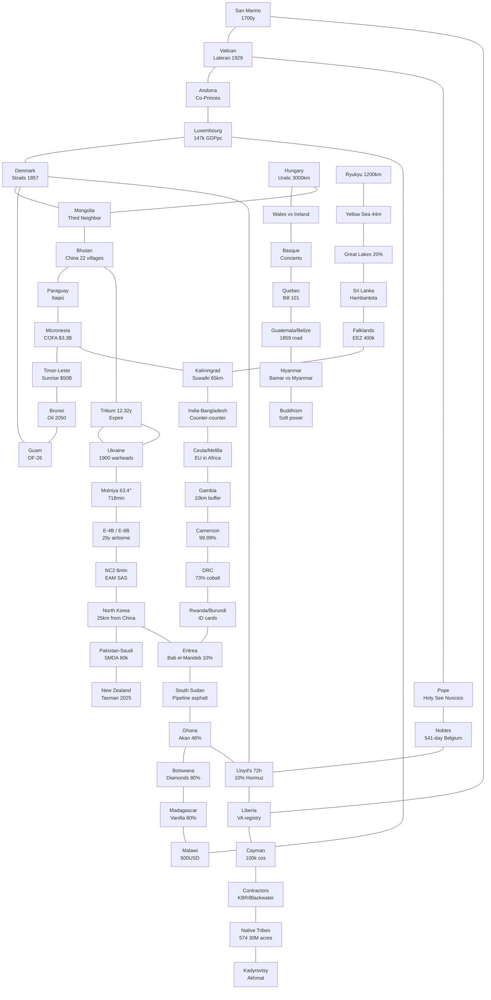

# Knowledge Graph: 100 Explainers, 6 Hidden Networks

> Each node is an explainer; edges are non-obvious connections that reveal the crazy stories.

## How to Read

- **Immortals (12):** Microstates survive via 4 cheat codes (museum → buffer → seller → remainder).
- **Nuclear Heartbeat (8):** Chemistry (tritium) → orbit (Molniya) → aircraft (E-4B) → decision (6 min) → periphery (Pakistan/NK/NZ).
- **Map That Eats (11):** Lines (Berlin 1885) → Prize (cobalt/diamonds/vanilla) → Bill (Nigeria bandits/South Sudan pipeline/Ghana default) → Mirror (Luxembourg).
- **Language Ghosts (8):** Time capsules (Hungary 3000km, Basque isolate) → survivors (Wales vs Ireland) → border forges (Quebec/Belize/Myanmar).
- **Straitjacket (9):** Deep vs shallow vs narrow valves — same plumbing law.
- **Shadow Sovereigns (9):** Tax/flag/rifle tripod privatized.

## Most Surprising Bridges (Verified)

1. **San Marino 1.6 cars/person ↔ Liberia flag:** Both inflate stats via registration arbitrage (cars in San Marino for Italian tax; ships in Virginia for Liberian flag).
2. **Bhutan 22 villages ↔ Tritium half-life:** Both measured by satellites (Planet Labs) — one maps annexation, one maps decay.
3. **Molniya 63.4° ↔ Denmark straits 1857:** Both solve a 19th-century latitude problem with math (frozen orbit vs treaty ban on tolls).
4. **Eritrea Bab el-Mandeb 10% ↔ Lloyd's 10% Hormuz:** Same percentage, opposite lever — one *owns* the strait, one *prices* it.
5. **Paraguay Itaipú must-sell ↔ Bhutan hydro must-sell:** Identical 1973/2007 contract language, both renegotiated 2026.

See `../stories/` for narrative versions.
