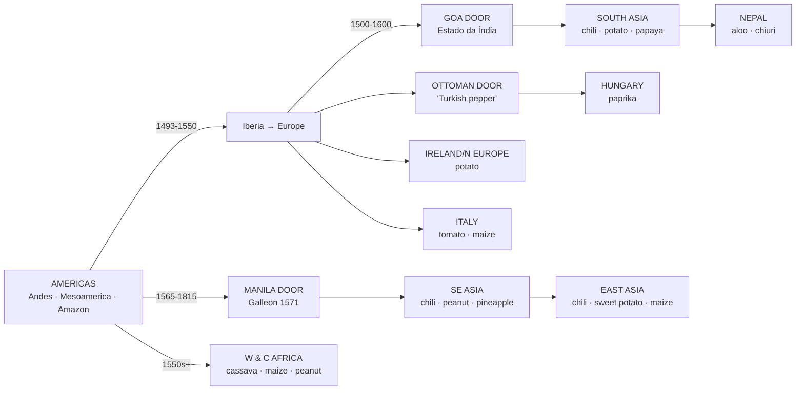

# Spread Map — the two-door world

> Read with [[traces/chili-two-doors]] — three doors, one shrub. Old World → Americas reverse arrows live in [[../passports/Wheat|Wheat]]/[[../passports/Sugarcane|Sugarcane]]/[[../passports/Coffee|Coffee]] (inbound passports).
