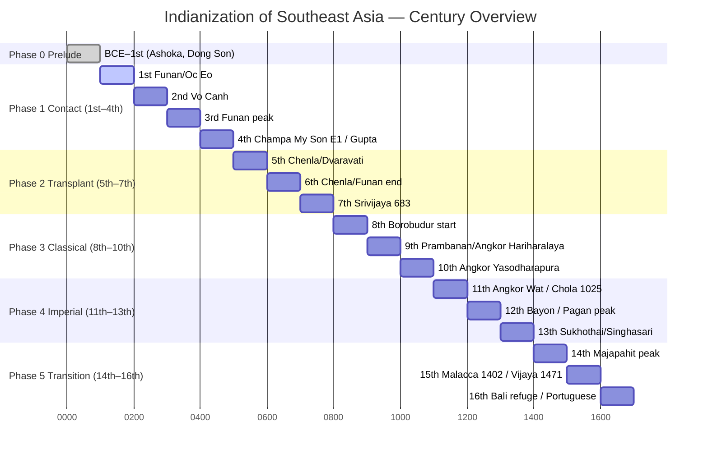

# Sources — By Century

> Every century from BCE prelude to 16th c. afterglow. Each folder = `README.md` (story list) + `timeline.md` (dated events).

## Visualization — 6 Phases as Gantt

## Century Folders

| Folder | Century | Phase | Anchor Event | Trace Link |
|--------|---------|-------|--------------|------------|
| [`00-bce-prelude/`](./00-bce-prelude/) | BCE–1st | 0 Prelude | Ashoka rock edicts, Tamil-Bengal ships | → trade-maritime |
| [`01-1st-century/`](./01-1st-century/) | 1st | 1 Contact | Funan Oc Eo entrepôt, Kaundinya legend | → funan-chenla |
| [`02-2nd-century/`](./02-2nd-century/) | 2nd | 1 Contact | **Vo Canh** inscription (oldest Sanskrit) | → sanskrit-pallava |
| [`03-3rd-century/`](./03-3rd-century/) | 3rd | 1 Contact | Funan Fan Shiman, Champa Lâm Ấp | → champa |
| [`04-4th-century/`](./04-4th-century/) | 4th | 1 Contact | Champa My Son E1 (Bhadravarman), Gupta start | → champa |
| [`05-5th-century/`](./05-5th-century/) | 5th | 2 Transplant | Chenla rise, Dvaravati Dharma wheels | → dvaravati |
| [`06-6th-century/`](./06-6th-century/) | 6th | 2 Transplant | Champa My Son A1, Kedah proto-city | → kedah-srivijaya |
| [`07-7th-century/`](./07-7th-century/) | 7th | 2 Transplant | **Kedukan Bukit 683** (Srivijaya), Xuanzang | → kedah-srivijaya |
| [`08-8th-century/`](./08-8th-century/) | 8th | 3 Classical | **Borobudur start ~782**, Kalasan 778, Jayavarman II 802 | → sailendra-mataram |
| [`09-9th-century/`](./09-9th-century/) | 9th | 3 Classical | Borobudur done, Prambanan, Angkor Hariharalaya | → angkor |
| [`10-10th-century/`](./10-10th-century/) | 10th | 3 Classical | Yasodharapura (Angkor), Chola maritime | → angkor |
| [`11-11th-century/`](./11-11th-century/) | 11th | 4 Imperial | Angkor Wat 1113, **Chola raid 1025** on Srivijaya | → vectors/trade-maritime |
| [`12-12th-century/`](./12-12th-century/) | 12th | 4 Imperial | Bayon, Pagan peak, Theravada turn | → vectors/buddhism |
| [`13-13th-century/`](./13-13th-century/) | 13th | 4 Imperial | Sukhothai, Singhasari, Mongol Java 1293 | → majapahit |
| [`14-14th-century/`](./14-14th-century/) | 14th | 5 Transition | Majapahit Nagarakretagama | → majapahit |
| [`15-15th-century/`](./15-15th-century/) | 15th | 5 Transition | Malacca 1402, **Vijaya 1471** fall of Champa, Angkor 1431 | → champa |
| [`16-16th-century/`](./16-16th-century/) | 16th | 5 Afterglow | Demak, Bali Hindu refuge, Portuguese 1511 | → bali |

## How to Use

- **Chronological:** Start in a century → read its `timeline.md` → jump to `../../regions/<name>` for that polity's full arc.
- **Regional:** Starting from Champa? Open `champa` region then follow its timeline *across* centuries back to `sources/`.
- **Vector:** Following Buddhism? Open `vectors/buddhism` — it links to the century where Borobudur vs My Son diverge.

Each `README.md` inside a century lists *stories* (narratives) for that slice; each `timeline.md` is the dated ledger (inscriptions, temples, Chinese annals). Both are stubs — next ingestion fills them with cited sources.

## Next Visualization

- Region spread map → [`../visualizations/spread-map.md`](../visualizations/spread-map.md)
- Influence matrix (region × vector heat) → [`../visualizations/influence-matrix.md`](../visualizations/influence-matrix.md)
