# Spread Map — How Indianization Traveled (Extended: Rome to Timor)

```mermaid
flowchart LR
    Rome["Rome/Alexandria<br/>Periplus 40CE<br/>Muziris Peppercorn"]
    Persia["Persia Ctesiphon<br/>Sasanian 224-651<br/>Sogdians Samarkand"]
    Gandhara["Gandhara<br/>Taxila/Peshawar<br/>Kanishka 78CE<br/>Bamiyan 507/554"]
    Himalaya["Himalaya<br/>Nepal Licchavi 464<br/>Bhutan Kyichu 649"]
    Lanka["Sri Lanka<br/>Mahinda 246BCE<br/>Anuradhapura<br/>Tooth Relic 310CE"]
    India["India<br/>Pallava Kanchi<br/>Nalanda<br/>Amaravati"]
    OcEo["Oc Eo (Funan)<br/>1st-6th<br/>Roman bracteate Antoninus Pius"]
    Kedah["Kedah<br/>Sungai Batu 535BCE<br/>Iron"]
    Srivijaya["Srivijaya Palembang<br/>683 Kedukan Bukit"]
    Champa["Champa My Son/Po Nagar<br/>Bhadravarman 380"]
    Java["Java Borobudur 782<br/>Sailendra"]
    Angkor["Angkor 802 Devaraja<br/>Wat 1113"]
    China["China<br/>Chang'an/Nalanda<br/>Xuanzang 629<br/>Yijing 671"]
    Pagan["Pagan 1057<br/>Theravada via Lanka"]
    Malacca["Melaka 1402<br/>Timor Sandalwood"]
    Timor["Timor 1225 Zhufan Zhi<br/>Sandalwood"]
    Bali["Bali Hindu refuge<br/>subak"]

    Rome -->|Gold for pepper<br/>Periplus| India
    Persia -->|Sogdian letters 313<br/>Kalila 570| India
    India -->|Kharosthi 518BCE| Gandhara
    Gandhara -->|Lokaksema 147<br/>Kharosthi scrolls| China
    Gandhara -->|Greco-Buddhist art| Himalaya
    India -->|Monsoon winds| OcEo
    Rome -->|Antoninus Pius bracteate| OcEo
    OcEo --> Kedah
    Himalaya -->|Bhrikuti 632 Tibet| China
    Lanka -->|Mahinda 246BCE<br/>Faxian 410<br/>Parakramabahu 1153| Pagan
    Pagan -->|Ramkhamhaeng 1283| Angkor
    India -->|Pallava script| Champa
    India -->|Pallava script| Kedah
    Kedah --> Srivijaya
    Srivijaya --> Champa
    Srivijaya --> Java
    Srivijaya -->|Yijing 671| China
    Java --> Angkor
    Kedah -->|Timor sandalwood 1225| Malacca
    Timor --> Malacca
    Malacca -->|Islam 1414| Java
    Java -->|Lontar palm to Bali 1527| Bali
    China -->|Quanzhou Kaiyuan 686| Srivijaya

    style India fill:#f9f,stroke:#333,stroke-width:2px
    style Srivijaya fill:#ff9,stroke:#333,stroke-width:2px
    style Gandhara fill:#ccf,stroke:#333
    style Rome fill:#fcc,stroke:#333
    style Persia fill:#ffc,stroke:#333
```

> **Extended:** Now shows full circuit Rome–Persia–Gandhara–India–Himalaya–Lanka–Oc Eo–Kedah–Srivijaya–Java–China, plus Timor sandalwood and Bali refuge. Monsoon + Silk Road + Sogdian letters.

> See `regions/gandhara/timeline.md`, `regions/rome-byzantium/timeline.md`, `regions/persia/timeline.md` for dated rows.
